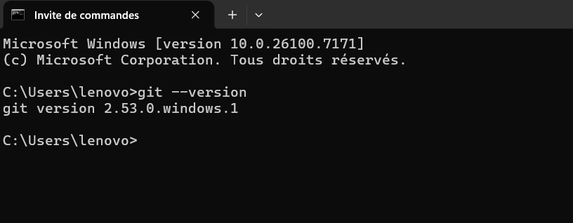
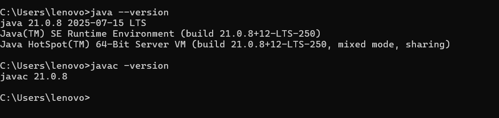
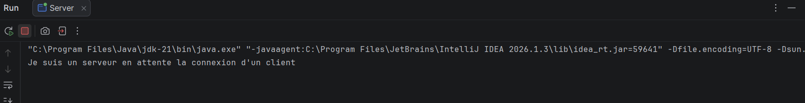
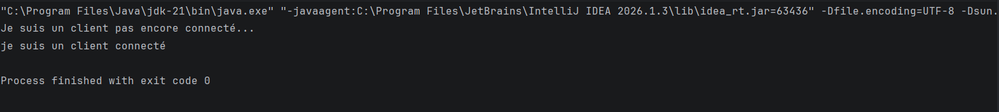
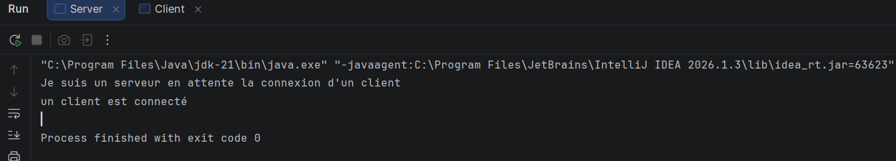
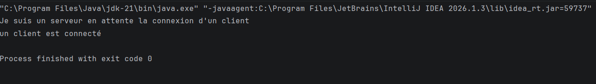

# TP1 : Les sockets en mode connecté TCP

## Activité 1-1 : Première connexion Client/Serveur

**Matière :** Développement d'applications réparties  
**Classe :** LSI3  
**Année universitaire :** 2026–2027

## Étape 1 : Préparation de l'environnement Git

Afin de vérifier l'installation de Git, nous avons exécuté la commande suivante dans le terminal Windows :

`git --version`

**Résultat obtenu :** `git version 2.53.0.windows.1`

Cette commande confirme que Git est correctement installé et accessible depuis le terminal Windows.

### Capture d'écran

## Étape 2 : Préparation de l'environnement Java

Afin de vérifier l'installation de Java, nous avons exécuté les commandes suivantes dans le terminal Windows :

`java --version`

`javac -version`

**Résultat obtenu :** Java 21.0.8 LTS.

Cette version est compatible avec les exigences du TP, qui nécessite au minimum le JDK 8. La commande `javac -version` permet de vérifier la disponibilité du compilateur Java.

### Capture d'écran

## Étape 3 : Création du serveur TCP

Nous avons créé le package `serverPackage` contenant la classe `Server.java`.

Le serveur utilise la classe `ServerSocket` pour écouter les connexions TCP sur le port 1234.

La méthode `accept()` permet au serveur d'attendre la connexion d'un client.

### Résultat de l'exécution

Après avoir lancé le serveur, le message suivant apparaît dans la console :

`Je suis un serveur en attente la connexion d'un client`

### Interprétation

Le serveur a démarré correctement et attend une demande de connexion TCP. La méthode `accept()` bloque l'exécution jusqu'à ce qu'un client se connecte. Une fois la connexion établie, le serveur affichera le message « un client est connecté ».
## Étape 4 : Création du client TCP

Nous avons créé le package `clientPackage` contenant la classe `Client.java`.

Le client utilise la classe `Socket` pour établir une connexion TCP avec le serveur à l'adresse `localhost` sur le port `1234`.

### Résultat de l'exécution

Après avoir lancé le client, les messages suivants apparaissent dans la console :

`Je suis un client pas encore connecté...`

`je suis un client connecté`

### Interprétation

Le premier message indique que le client n'est pas encore connecté au serveur.

Après l'exécution de `new Socket("localhost", 1234)`, la connexion TCP est établie et le deuxième message apparaît.

Le programme se termine normalement avec le code de sortie 0, après la fermeture de la socket.
### Résultat après la connexion du client

Après le lancement de l'application client, le serveur accepte la connexion TCP et affiche les messages suivants :

`Je suis un serveur en attente la connexion d'un client`

`un client est connecté`

**Interprétation :**

Le premier message indique que le serveur est démarré et attend une connexion grâce à la méthode `accept()`.

Le deuxième message confirme qu'un client a réussi à établir une connexion TCP avec le serveur sur le port 1234.

Une fois la connexion acceptée, les sockets sont fermées et le programme serveur se termine normalement.

### Capture d'écran du serveur connecté

### Test de connexion avec une adresse IP

Dans cette étape, nous avons remplacé `localhost` par l'adresse IP `127.0.0.1` dans la classe `Client.java`.

La connexion s'effectue désormais avec l'instruction :

`Socket socket = new Socket("127.0.0.1", 1234);`

**Interprétation :**

L'adresse `127.0.0.1` correspond à l'interface locale de l'ordinateur. Le client et le serveur communiquent donc toujours sur la même machine.

Après l'exécution du client, la connexion TCP est établie avec succès sur le port 1234.

**Capture d'écran :**

---

# Activité 1-2 : Service de calculatrice

## 1. Objectif

L'objectif de cette activité est d'étendre l'application Client/Serveur développée dans l'Activité 1-1 afin d'ajouter un service de multiplication côté serveur, en utilisant les sockets TCP.

## 2. Fonctionnement de l'application

Le client demande à l'utilisateur de saisir un entier `x`, puis l'envoie au serveur.

Le serveur reçoit cet entier, effectue la multiplication `x * 5`, puis renvoie le résultat au client.

La communication est réalisée à l'aide des classes `DataInputStream` et `DataOutputStream`, qui permettent notamment de transmettre correctement les entiers négatifs.

## 3. Tests de multiplication

### Test avec un entier positif

Le client envoie `4` au serveur. Le serveur calcule `4 * 5 = 20` et renvoie le résultat.

### Test avec un entier négatif

Le client envoie `-3`. Le serveur calcule `-3 * 5 = -15`.

### Test avec zéro

Dans la première version de l'application, le client envoie `0` et le serveur renvoie le résultat `0`.

## 4. Communication avec DataInputStream et DataOutputStream

Les classes `DataInputStream` et `DataOutputStream` permettent de transmettre des entiers entre le client et le serveur.

- `writeInt(x)` : envoie un entier.
- `readInt()` : reçoit un entier.

Ces méthodes permettent de gérer les entiers positifs, négatifs et nuls.

## 5. Plusieurs calculs successifs

L'application a été modifiée pour permettre au client de saisir plusieurs entiers successivement sans redémarrer la connexion.

Une boucle `do...while` est utilisée dans les deux applications.

Exemple de test :

| Entier envoyé | Résultat reçu |
|---------------|---------------|
| 4             | 20            |
| 5             | 25            |
| 2             | 10            |

## 6. Arrêt de la communication

Lorsque l'utilisateur saisit `0`, le client envoie cette valeur au serveur.

Le serveur détecte cette valeur et arrête la boucle de calcul.

Les sockets sont ensuite fermées proprement des deux côtés.

### Fermeture côté client

### Fermeture côté serveur

## 7. Conclusion

Cette activité a permis d'étendre l'application Client/Serveur TCP de l'Activité 1-1 en ajoutant un service de multiplication par 5.

Elle a également permis de mettre en œuvre une communication répétée entre le client et le serveur, avec une fermeture propre de la connexion lorsque l'utilisateur saisit `0`.